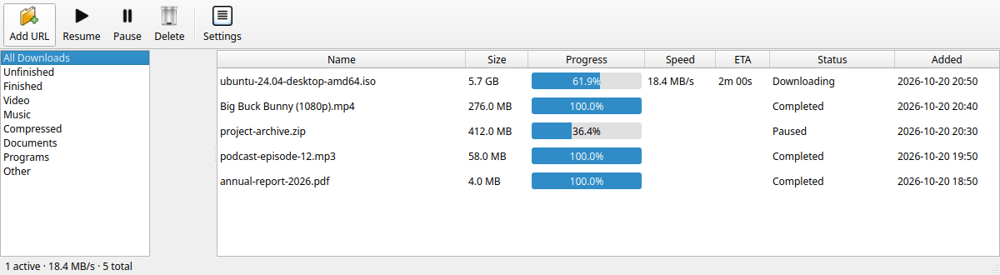
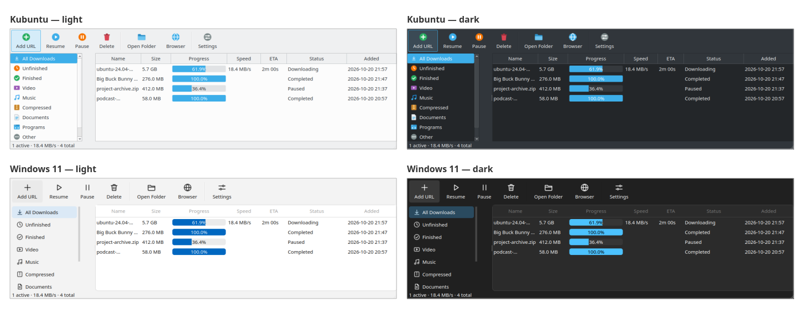

# Warpdown — fast download manager

An open-source, [Internet Download Manager](https://www.internetdownloadmanager.com/)-style download manager for
Linux, built and tested on Kubuntu (KDE Plasma, Wayland). Fast multi-connection downloads, a browser extension that
takes over downloads and grabs videos, subtitles, and YouTube support through yt-dlp.



## Features
- **Fast segmented downloads** — up to 32 connections, with *dynamic segment splitting*: a connection that finishes
  early takes over half of the largest remaining piece, so all connections stay busy to the end
- **Pause / resume**, also across restarts (servers that support HTTP Range)
- **Automatic retry** — temporary network or server problems (timeouts, resets, 5xx, 429) are retried after 15 s,
  30 s, 1 min, 2 min, then every 5 min, up to a limit you choose; permanent errors (404, no space, …) are shown at once
- **Batch downloads** — paste a list of addresses, or use ranges: `photo[01-20].jpg`, `file[1-100:5].zip`,
  `part_[a-f].rar` (up to 10,000 per batch)
- **Scheduler** — hold downloads and run them at night: either in a window (e.g. 23:00–06:00, selected days) or
  released at a start time and run until finished; then optionally *quit / sleep / shut down* (with a 60-second
  chance to cancel)
- **Clipboard watcher** (off by default) — copy a link to a file or video and Warpdown offers to download it; on KDE
  it reads Klipper over D-Bus, so it also works under Wayland while Warpdown sits in the tray
- **Queue** with a configurable number of simultaneous downloads. Reorder it (*right-click → Queue position*, or
  `Alt+Up` / `Alt+Down` / `Alt+Home` / `Alt+End`) and set a **priority** (high / normal / low): the list is shown in
  the order downloads start
- **Speed limits** — a global limit, an optional *different limit during chosen hours* (e.g. slow by day, unlimited at
  night), and a limit for single downloads (*right-click → Speed limit for this download…*)
- **Checksum verification** — paste a SHA-256 / SHA-512 / SHA-1 / MD5 checksum (*right-click → Verify checksum…*) and
  get a ✓ or ✗; Warpdown also looks for a published `NAME.sha256` (etc.) next to a downloaded file and checks it
  automatically (can be turned off in Settings)
- **Drag and drop** — drop `.torrent` files, magnet links or web addresses on the window; *Add URL* also has a
  *Torrent file…* button. *Settings → Start Warpdown when I log in* keeps it in the tray so browser hand-offs are instant
- **Torrents and magnet links** — `magnet:` links, `.torrent` addresses and `.torrent` files, downloaded with
  [aria2](https://aria2.github.io) (`sudo apt install aria2`; on Windows put `aria2c.exe` next to Warpdown or in your
  PATH). Warpdown registers as the handler for magnet links and does not seed after finishing
- **VPN guard** — *Settings → Pause all downloads while no VPN is connected*: downloads stop as soon as the VPN drops
  and continue when it is back. It looks for a VPN network interface (WireGuard, OpenVPN, ProtonVPN, Mullvad,
  Tailscale, …); it is a convenience, not a firewall kill-switch
- **Search** the list (`Ctrl+F`) and **statistics** (*Statistics* in the toolbar): downloaded today, this week, this
  month and in total, a 14-day chart, and a breakdown by file type
- **Update notice** — about once a day Warpdown asks GitHub for the newest release and shows *Update available* in the
  status bar (once as a tray message). It never installs anything by itself; switch it off in *Settings*
- **Plain-language errors** — a failed download says what went wrong and what to try; the technical text is in the
  tooltip and *Copy error details*
- **IDM-style category folders** — Video, Music, Compressed, Documents, Programs, Images, Other — created automatically;
  files are sorted into them (file types are recognised from the name, `Content-Type` or the file's first bytes)
- **Browser integration** (Firefox and Chromium family): takes over browser downloads, a "Download with Warpdown"
  context menu, and a floating **Download this video** button over page videos (full, compact arrow-only, or hidden — your choice in the
  toolbar popup)
- **Download all links on a page** — from the toolbar popup or the right-click menu (also *only the links in your
  selection*): a picker lists the page's links, images and media with filters by type and by words, *select all /
  none / invert*, and one destination folder. Hundreds of files in one go; cookies of the page are only ever sent to
  the page's own site
- **Video streams**: plain files and **HLS (`.m3u8`)** streams, including AES-128 encrypted ones, merged to MP4
  with ffmpeg. *DRM-protected streams are not supported and never will be.*
- **Subtitles**: pick which tracks to save (`.vtt` / `.srt` / `.ass`), stored next to the video with the language in
  the name (`Movie.eng.vtt`) so players like Haruna and mpv pick them up automatically
- **yt-dlp mode** for YouTube, Vimeo and many other sites: choose quality (best / 1080p / … / audio-only MP3),
  H.264/AAC MP4 output, subtitles. The browser button falls back to it when a page has no plain file or HLS stream
- **Folders at a click** — an *Open Folder* toolbar button, and double-clicking *Video*, *Music*, … in the left list
  opens that folder
- **Browser extension helper** — *Browser* in the toolbar (or Settings) guides you through adding the extension to
  Firefox or Chrome and registering the connector
- **Themes** — pick a *Style* (System default, Kubuntu, Windows 11) and a *Mode* (Follow system, Light, Dark) in
  Settings; each style has its own colours, shapes and icon set, with a live preview
- **Adjustable text size** — *Settings → Text size* (live preview), or `Ctrl +` / `Ctrl -` / `Ctrl 0` in the main window
- Tray icon, completion notifications, pure Python + Qt (PySide6). aria2 is only needed for torrents

### Themes


## Install on Windows 10 / 11
1. Download **`warpdown-setup-<version>.exe`** from the [latest release](https://github.com/marius-101/warpdown/releases/latest)
   (or the portable `.zip`, which needs no installation).
2. Run it. The installer is not code-signed yet, so Windows SmartScreen may say *"Windows protected your PC"*:
   click **More info → Run anyway**. It installs for your user only (no administrator rights).
3. Start Warpdown, then press **Browser** in the toolbar to add the Firefox add-on (or Chrome/Edge/Brave).

The Windows program includes yt-dlp, ffmpeg and aria2, so video sites, merging and torrents work out of the box.
It is built and smoke-tested automatically on a Windows machine (GitHub Actions) for every change.

## Install (Kubuntu / Ubuntu / Debian)
```bash
sudo apt install python3-venv ffmpeg libxcb-cursor0     # ffmpeg: merging video/audio; libxcb-cursor0: Qt on X11
git clone https://github.com/marius-101/warpdown.git
cd warpdown
python3 -m venv .venv
.venv/bin/pip install -r requirements.txt
.venv/bin/python -m warpdown                                 # start Warpdown (add a URL as an argument to download it)
```
For **full YouTube quality** also install a JavaScript runtime: `sudo apt install nodejs`.

## Browser integration
```bash
native/install.sh        # registers the native-messaging host and a desktop launcher
```
**Firefox** (Mozilla-signed, stays installed across restarts)
1. Open **[warpdown.xpi](https://github.com/marius-101/warpdown/releases/latest/download/warpdown.xpi)** in Firefox
   (or press *Browser → Install the Firefox add-on* inside Warpdown). Choose **Allow**, then **Add**.
   If Firefox saves the file instead, open it with *File → Open File*.
2. Click the Warpdown toolbar icon and, if it shows a yellow notice, press **Grant access**
   (needed for the video button).
3. *Flatpak Firefox?* The installer prints one extra command to allow the native host; run it and restart Firefox.

*Developers:* to test a build from source, run `native/build_xpi.sh` and load `dist/warpdown.xpi` from
`about:debugging#/runtime/this-firefox` → *Load Temporary Add-on…*.

**Chrome / Chromium / Brave** — load the `extension/` folder unpacked, copy the extension ID, then run
`WARPDOWN_CHROME_EXTENSION_ID=<id> native/install.sh`.

### Using it
- **Download all links:** click the toolbar icon → *Download all links on this page…* (or right-click the page). If
  you select some text first, only the links inside the selection are collected.
- Click a download link as usual — Warpdown takes over and asks where to save it.
- Hover over a video and press **Download this video**. On sites where the page itself is the source
  (YouTube, …) it opens Warpdown's yt-dlp mode.
- Settings has the default folder, connections, speed limit, subtitle languages, and an **Update yt-dlp** button
  (video sites change often; if a site stops working, update first).

## Development
```bash
QT_QPA_PLATFORM=offscreen .venv/bin/python -m pytest      # tests run against local servers; no internet needed
```
Layout: `warpdown/` (engine, HLS, subtitles, yt-dlp, manager, Qt GUI), `extension/` (browser extension),
`native/` (native-messaging host + installer), `tests/`.

## Roadmap
**Windows support** (installer + native-messaging registration), DASH (`.mpd`) streams, scheduler, site logins, per-site rules, checksum verification, batch / URL-pattern downloads,
signed Firefox add-on, `.deb` / Flatpak packaging.

## Responsible use
Warpdown is a tool; you are responsible for what you download. Respect copyright and the terms of the sites you use.

## License
[MIT](LICENSE)
